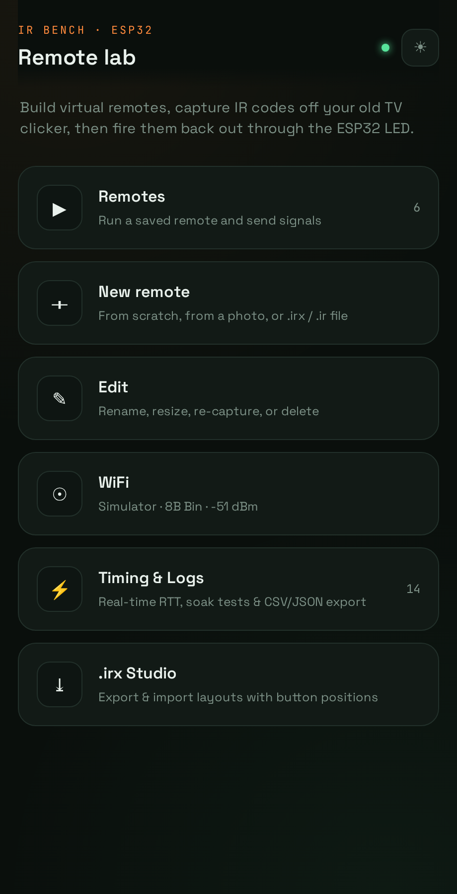
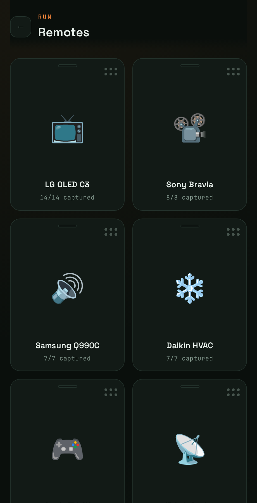
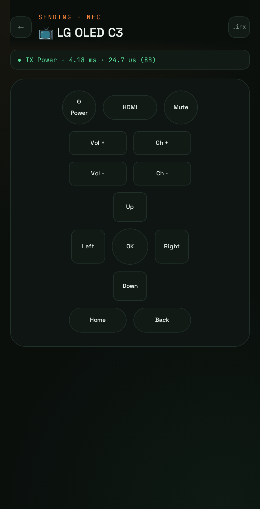
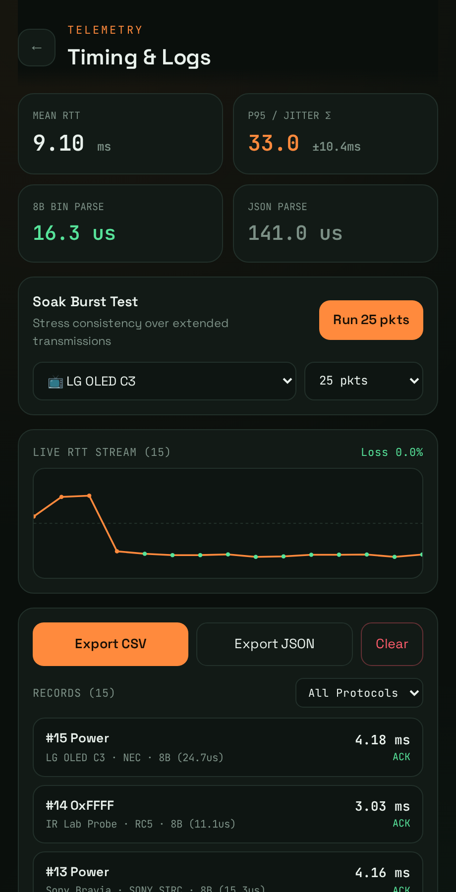
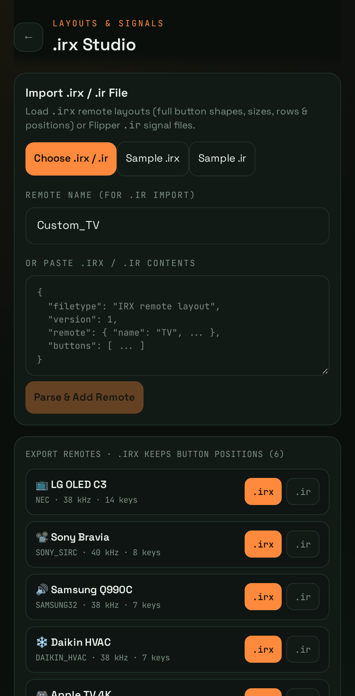
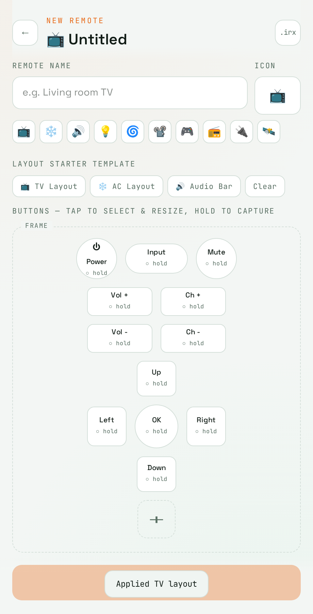

# IRBench Studio — ESP32 IR Remote Lab & Latency Bench

**IRBench Studio** is a full-stack infrared remote builder, signal capture tool, and transmission latency workbench for **ESP32**. It keeps a unified hardware-bench aesthetic across the **Web Dashboard**, **Native Kotlin Android App (Android 7.0 – 15)**, and **PlatformIO ESP32 Firmware**, sharing a single structured **`.irx`** remote layout format alongside Flipper Zero **`.ir`** compatibility.

---

## Screenshots

| Home (`Remote lab`) | Remotes Grid | Run Remote (`LG OLED C3`) |
| :---: | :---: | :---: |
|  |  |  |

| Timing & Logs | `.irx` Studio | Builder & Light Theme |
| :---: | :---: | :---: |
|  |  |  |

---

## Key Features

- **Organized Preset Remotes & Builder Templates**: Pre-configured remotes (`LG OLED C3`, `Sony Bravia`, `Samsung Q990C`, `Daikin HVAC`, `Apple TV 4K`, `IR Lab Probe`) and 1-tap starter templates (`TV Layout`, `AC Layout`, `Audio Bar`) arranged in symmetrical row/column chassis layouts.
- **Centered Icon Cards & Scroll Retention**: Remote tiles render centered icons above labels and captured counts; navigating back after opening or editing a remote restores the previous scroll position.
- **`.irx` Remote Layout Format**: JSON-based `.irx` format preserving remote metadata and exact button structure (`shape`, `w`, `h`, `row`, `col`, `x`, `y`, `order`, `emoji`, `captured`, protocol payload, and raw timings), plus full `.ir` (Flipper Zero / IRDB) import & export.
- **Low-Overhead 8-Byte Binary Protocol**: Compact 8-byte `IRCommandFrame` (`protocol_id`, `carrier_khz`, `cmd_hash`, `payload`) over HTTP/Wi-Fi alongside legacy JSON comparison, reducing ESP32 command parsing from ~140 µs to ~15 µs.
- **Live Telemetry & Soak Testing**: Real-time RTT tracking, p95 / standard deviation jitter analytics, burst soak tests, and CSV / JSON telemetry export.
- **Dark & Light Themes**: Green-black (`#0A0F0C`) + amber-orange (`#FF8A3D`) workbench theme with persistent Light mode toggle.
- **Photo-Overlay & Hold-to-Capture Modes**: Build remotes from shapes or tap coordinates onto an uploaded remote photo, then hold buttons to capture live IR bursts from the ESP32 receiver (`/ir/rx`).

---

## Repository Structure

```text
├── .github/workflows/
│   └── build-release.yml      # CI workflow: builds ESP32 firmware, Android APK, Web bundle & GitHub Release
├── android/                   # Native Kotlin + Jetpack Compose app (minSdk 24 / targetSdk 35)
├── docs/
│   └── screenshots/           # Captured UI screenshots
├── firmware/                  # PlatformIO ESP32 / ESP32-S3 firmware (TX/RX + 8B binary endpoint)
├── src/                       # React + TypeScript + Vite web dashboard
│   ├── components/            # BenchLogsView & IrStudioView
│   ├── data/                  # Organized presets, protocols & starter templates
│   ├── lib/                   # 8B binary frame client & .irx/.ir parsers
│   └── types/                 # Shared TypeScript interfaces
├── server.ts                  # Express backend proxy, binary/JSON parser & SSE telemetry stream
└── package.json
```

---

## Quick Start

### 1. Web Dashboard & Bench Server

```bash
npm install
npm run dev
```

Open `http://localhost:3000`. Switch between the built-in **Simulator** and **Real ESP32 on Local Wi-Fi** inside the **WiFi** menu.

### 2. ESP32 Firmware (`/firmware`)

Supports **ESP32 DevKit (`esp32dev`)** and **ESP32-S3 (`esp32-s3-devkitc-1`)** (`IR_TX_PIN=4`, `IR_RX_PIN=5` by default).

```bash
cd firmware
pio run -t upload
```

The firmware starts both station Wi-Fi (`WIFI_SSID` / `WIFI_PASS` in `firmware/src/main.cpp`) and a fallback SoftAP (`IRBench-ESP32` / `12345678`) with `WIFI_PS_NONE` enabled for low-jitter response.

| Endpoint | Method | Description |
| :--- | :---: | :--- |
| `/ir/tx` | `POST` | Accepts either an 8-byte `application/octet-stream` binary `IRCommandFrame` or JSON payload |
| `/ir/rx` | `GET` | Returns last captured IR frame + raw microsecond timings (`204` when idle) |
| `/health` | `GET` | Returns Wi-Fi SSID, IP, RSSI, channel, power-save mode, and TX count |
| `/config` | `POST` | Toggles `WIFI_PS_NONE` / `WIFI_PS_MIN_MODEM` |

### 3. Native Android App (`/android`)

Built with **Kotlin 2.0**, **Jetpack Compose (Material 3)**, **OkHttp**, and **Kotlinx Serialization**:
- **Android Version Range**: `minSdk = 24` (Android 7.0 Nougat) through `targetSdk = 35` (Android 15), with edge-to-edge system bars, predictive back navigation, and cleartext LAN Wi-Fi permission (`network_security_config.xml`).
- **Dual IR Transport**: Connects to the ESP32 over Wi-Fi (8B Binary or JSON) and also detects built-in hardware IR blasters (`ConsumerIrManager`) on supported Android devices.

```bash
cd android
gradle assembleDebug assembleRelease
```

---

## `.irx` File Format

`.irx` extends standard IR signal dumps with spatial UI layout metadata:

```json
{
  "filetype": "IRX remote layout",
  "version": 1,
  "remote": {
    "id": "lg-oled-c3",
    "name": "LG OLED C3",
    "emoji": "📺",
    "mode": "shapes",
    "manufacturer": "LG Electronics",
    "deviceType": "Display",
    "protocol": "NEC",
    "carrierKhz": 38
  },
  "buttons": [
    {
      "id": "power",
      "label": "Power",
      "emoji": "⏻",
      "category": "power",
      "layout": { "shape": "circle", "w": 60, "h": 60, "row": 0, "col": 0, "order": 0 },
      "signal": {
        "captured": true,
        "irType": "parsed",
        "codeHex": "0x20DF10EF",
        "addressBytes": "20 DF 00 00",
        "commandBytes": "10 EF 00 00"
      }
    }
  ]
}
```

---

## CI / Auto Release

Pushing to `main`/`master` or tagging `v*` triggers `.github/workflows/build-release.yml`, which:
1. Builds `irbench-esp32dev.bin` and `irbench-esp32s3.bin` via PlatformIO.
2. Builds `irbench-android-release.apk` and `irbench-android-debug.apk` via Gradle 8.9 (JDK 17).
3. Verifies the Vite + TypeScript web production bundle.
4. Publishes a GitHub Release attaching all firmware `.bin` and Android `.apk` artifacts.
